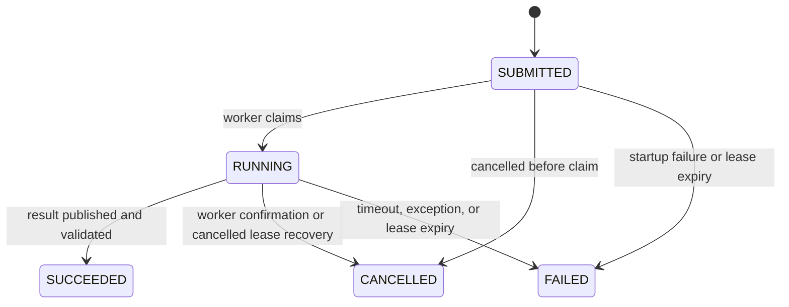

# Backtest jobs and results

[中文页面](jobs.zh-CN.md)

## Request protocol

The runtime accepts four request versions. v1 and v2 use `native.position_replay`, v3 uses `native.sequenced_execution`, and v4 uses `native.trade_accounting`.

| Version | Purpose | Required conditions | Result format |
| --- | --- | --- | --- |
| v1 | Diagnostic replay | `evidence_tier=diagnostic` | `ticknet.backtest_job_result.v1` |
| v2 | Replay with an execution ledger | `evidence_tier=execution_aware`, complete research clock, producer identity, and an enabled ledger | `quant.backtest_job_result.v2` |
| v3 | Multi-decision execution diagnostics | `evidence_tier=diagnostic`, one research clock per rebalance, and an enabled ledger | `ticknet.backtest_job_result.v1` |
| v4 | Trade-cost accounting for one weight adjustment | `evidence_tier=diagnostic`, content-hashed input, and non-negative finite rates | `quant.trade_accounting_result.v1` |

v2 requires both `execution.ledger=true` and `execution.ledger_config.enabled=true`. See the [v2 request example](https://github.com/runchengxie/quant-backtest-runtime/blob/main/examples/request-v2.json) and [`contracts.py`](https://github.com/runchengxie/quant-backtest-runtime/blob/main/src/backtest_runtime/contracts.py). Requests must supply the complete version-specific `config`, `execution` and `budgets` objects. The runtime does not fill omitted fields from backend defaults; unknown fields are rejected. Nullable fields still require their keys.

All request versions may include `quant_run_manifest_ref`, pointing to a typed `QuantRunManifest` in the same artifact store. Submission and worker validation check the manifest and the content hashes of its `component_refs`. Only v2 copies the validated root to `quant_run_manifest.json` in the result and records its hash and research run ID. v1, v3 and v4 validate this input but do not retain it in their published result. Keep the original request and artifact store for those versions.

v3 accepts `positions_ref`, `pricing_ref`, and `decision_clocks_ref`. The first two are Parquet files; the clock input is a JSON object no larger than 1 MiB keyed by rebalance date. All three use `artifact://sha256/<digest>`. The hashes in the [v3 request example](https://github.com/runchengxie/quant-backtest-runtime/blob/main/examples/request-v3.json) are placeholders and must be replaced with real input hashes before submission. Each date requires a complete `research.clock.v1`; the backend checks target, entry, and valuation dates.

v4 `accounting_ref` points to a Parquet table with `symbol`, `previous_weight`, `target_weight`, `previous_price`, `current_price`, and `tradable`. `config` contains only `commission_rate`, `stamp_tax_rate`, and `slippage_rate`; `execution` is an empty object. The hashes in the [v4 request example](https://github.com/runchengxie/quant-backtest-runtime/blob/main/examples/request-v4.json) are placeholders. This diagnostic convention does not represent actual execution.

All committed request examples use placeholder content hashes. Their request shapes can be validated, but they require matching real input files before execution. `scripts/create_example.py` instead creates matching synthetic v2 inputs and a request.

Request files must be ordinary JSON files no larger than 64 KiB. `idempotency_key` matches `[A-Za-z0-9][A-Za-z0-9._:-]{0,127}`. Reusing a key with the same request returns the existing job; binding the key to different content is an error. Use a new key when changing parameters.

Inputs use `artifact://sha256/<digest>` and are stored below `<artifact-root>/sha256/<digest>`. v1 and v2 require `positions_ref`, `pricing_ref`, and `periods_ref`; `intraday_bars_ref` is optional. The worker verifies each input SHA-256 before reading it. Callers own input creation and immutability.

`budgets.wall_seconds` ranges from 1 to 86400 and `budgets.memory_mb` from 256 to 65536. The memory limit covers the process virtual address space, including imported dependencies. A job fails when resource limits cannot be applied.

## Research clocks

v2 callers provide a complete `research.clock.v1`. A v2 job represents one decision. The `rebalance_date` in the positions and periods tables must equal the information cutoff date, and the entry date must fall within the earliest order date and the end of the execution window. Pricing data may not be later than the valuation date. The runtime also checks order, fill, and NAV dates.

Research clocks do not prove an intraday fill time. Callers must provide a window covering the complete replay period and separately establish that signal inputs were available at the cutoff.

## CLI lifecycle

Every `backtest-job` command requires `--database`, `--artifact-root` and `--result-root` before the subcommand. There are no default data paths or locale option. For an isolated synthetic example, run from the repository root:

```bash
runtime_data_root=$(mktemp -d)
uv run --locked python scripts/create_example.py --output "$runtime_data_root"
uv run --locked backtest-job \
  --database "$runtime_data_root/jobs.sqlite" \
  --artifact-root "$runtime_data_root/artifacts" \
  --result-root "$runtime_data_root/results" \
  submit "$runtime_data_root/request.json"
```

`create_example.py --output` takes a directory and refuses to overwrite its existing request. Keep that temporary directory for the following commands; use a stable external data directory for retained jobs.

| Subcommand | Successful JSON output and behavior |
| --- | --- |
| `submit REQUEST` | `job_id`, `status`, `created`; starts a separate worker while the receipt is `SUBMITTED` |
| `status JOB_ID` | Job status, timestamps, cancellation, result, error and PID fields; also recovers expired jobs |
| `cancel JOB_ID` | Job status after recording cancellation and attempting to signal a matching worker |
| `result JOB_ID` | The verified version-specific result manifest; requires `SUCCEEDED` and does not run lease recovery |
| `recover` | `recovered`, counting newly expired state transitions rather than cleanup attempts |

Replace only the last `submit REQUEST` portion of the command above to use another subcommand, retaining all three paths. `status` is not a read-only query because recovery can change state and remove unpublished output. CLI parse errors exit with code `2`; request, state and integrity errors exit nonzero and may emit a traceback on stderr rather than a JSON error. The `backtest-worker` entry point is the runner used by the CLI; its database argument is named `--registry`.

Status objects contain `job_id`, `status`, `created_at`, `updated_at`, `cancel_requested_at`, `result_ref`, `result_sha256`, `error_code`, `error_message` and `worker_pid`. Unavailable optional values remain JSON `null`. The service API's `get_result` returns a reference; the CLI's `result` additionally validates the stored result files.

## State and recovery



Cancellation first records a request and then signals the worker confirmed to belong to the job. A completed job does not change state because of a repeated cancellation. `recover` handles expired leases; `submit` and `status` also trigger recovery. There is no resident scheduler, so unattended environments should run `recover` periodically.

A worker claim sets its lease to `wall_seconds + 30` seconds; CLI startup has a separate 60-second lease. A recorded cancellation prevents a later success transition. Recovery checks the command and job ID in `/proc`, then uses pidfd controls to terminate a matching expired worker and confirm its exit. If process inspection or termination cannot be completed, the job stays pending recovery. An absent or unrelated PID permits expiry without signaling an unrelated process. Expired running jobs become `CANCELLED` when cancellation was requested, otherwise `FAILED`.

### Recovery and durability boundary

Recovery tests cover process interruption and a result-directory rename followed by a failed state commit. A published directory alone does not make a job successful; lease recovery removes unpublished output.

Before committing `SUCCEEDED`, publication closes and `fsync`s every staged result file (including nested payloads and the manifest), syncs staging directories from leaves upward, renames the staged directory, and syncs the result parent directory. The result-root ancestry is also synced before staging, including directories created for this publication. A failed sync or rename prevents the success transition. A failure after rename can leave an unpublished directory for lease recovery to remove; existing lease fencing and result hash checks still apply.

This publication path requires POSIX directory `fsync`; Windows and filesystems that reject directory syncing fail closed rather than silently weakening the guarantee. Successful barriers request persistence according to the filesystem and storage stack; they do not establish a universal hardware or power-loss guarantee. Tests inject I/O faults and check ordering, not physical power loss. The `result` command checks integrity again when retrieving a successful result. Retain the request and its immutable, hash-addressed inputs so missing or rejected results can be rerun with a new idempotency key.

## Results and provenance

The worker publishes results to a task-specific directory and stores a manifest hash in SQLite. `result` validates job identity, request fingerprint, manifest hash, and every result-file hash before returning metadata. Modified files are rejected.

v1 and v3 results contain five diagnostic tables. v2 contains the platform `portfolio_backtester.backtest_result.v1` result package. v4 contains a one-row cost table. A successful job means that its result has been published and validated; it does not promote a strategy. Research promotion still requires source review and human approval in the research layer.

For v2's copied `QuantRunManifest`, `result` verifies the file hash, typed structure and research run ID. It does not reread component files from the external input store; those were checked at submission and worker validation. The research run ID and runtime job UUID are separate identities.
