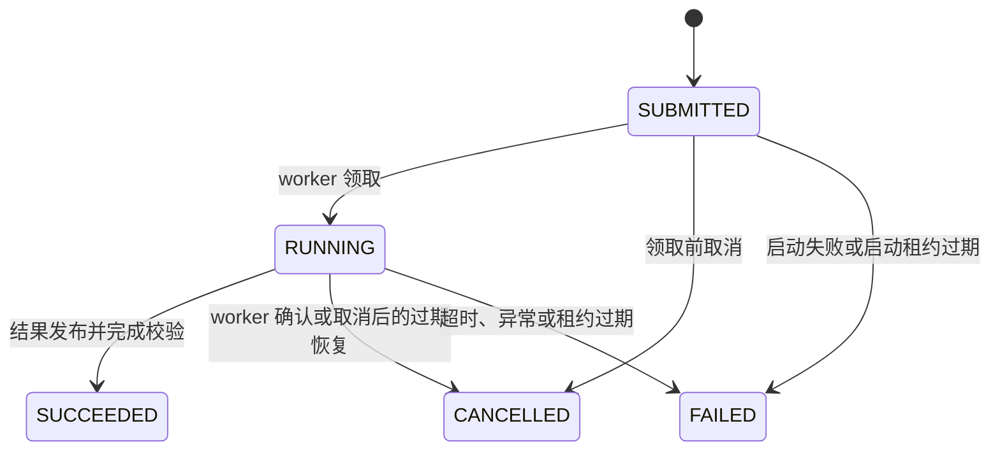
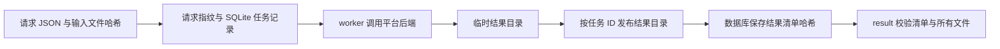

# 回测任务与结果

[English page](jobs.md)

## 请求协议

运行时接受四种请求。v1 和 v2 使用 `native.position_replay`，v3 使用 `native.sequenced_execution`，v4 使用 `native.trade_accounting`。

| 请求版本 | 用途 | 必要条件 | 结果格式 |
| --- | --- | --- | --- |
| v1 | 诊断回放 | `evidence_tier=diagnostic` | `ticknet.backtest_job_result.v1` |
| v2 | 带执行账本的回放 | `evidence_tier=execution_aware`、完整研究时钟、生产者身份、开启账本 | `quant.backtest_job_result.v2` |
| v3 | 多次决策的执行诊断 | `evidence_tier=diagnostic`、每次调仓各自的研究时钟、开启账本 | `ticknet.backtest_job_result.v1` |
| v4 | 单次权重调整的交易成本结算 | `evidence_tier=diagnostic`、内容哈希输入、非负有限费率 | `quant.trade_accounting_result.v1` |

v2 同时要求 `execution.ledger=true` 和 `execution.ledger_config.enabled=true`。完整字段见 [v2 请求示例](https://github.com/runchengxie/quant-backtest-runtime/blob/main/examples/request-v2.json)，校验实现见 [contracts.py](https://github.com/runchengxie/quant-backtest-runtime/blob/main/src/backtest_runtime/contracts.py)。请求须提供对应版本的完整 `config`、`execution` 和 `budgets` 对象。运行时不会从后端默认值补齐缺省字段，未知字段会被拒绝，允许为 `null` 的字段也须提供键。

各版本都可以提供 `quant_run_manifest_ref`，指向同一 artifact store 中的 typed `QuantRunManifest`。提交和 worker 会校验 manifest 及其 `component_refs` 的内容哈希。只有 v2 将已校验的根文件复制为结果中的 `quant_run_manifest.json`，并记录其哈希与研究运行 ID。v1、v3、v4 会校验该输入，但不会将它保留到发布结果中，须保留原请求和 artifact store。

v3 接受 `positions_ref`、`pricing_ref` 和 `decision_clocks_ref`。前两者为 Parquet，时钟输入为不超过 1 MiB 的 JSON 对象，以调仓日期为键；三者均使用 `artifact://sha256/<digest>`。仓库中的 [v3 请求示例](https://github.com/runchengxie/quant-backtest-runtime/blob/main/examples/request-v3.json)里的哈希仅为占位，提交前须写入真实输入文件并替换引用。每个日期须有独立且完整的 `research.clock.v1`，平台后端会核对目标、入场与估值日期。v3 保留诊断证据等级，不把缺少来源可见性证明的历史回放标记为正式执行证据。

v4 的 `accounting_ref` 指向一张 Parquet 表，列为 `symbol`、`previous_weight`、`target_weight`、`previous_price`、`current_price` 和 `tradable`。`config` 仅含 `commission_rate`、`stamp_tax_rate` 和 `slippage_rate`，`execution` 为空对象。仓库中的 [v4 请求示例](https://github.com/runchengxie/quant-backtest-runtime/blob/main/examples/request-v4.json)里的哈希为占位。平台后端按价格漂移后的权重计算成交与成本，runtime 保存单行 `accounting.parquet` 与哈希清单；`result` 验证后返回换手及分项成本。此诊断口径不代表真实成交。

仓库请求示例都使用占位内容哈希。可以校验请求结构，但执行前须提供匹配的实际输入文件。`scripts/create_example.py` 则生成匹配的 v2 合成输入与请求。

请求文件必须是普通 JSON 文件，大小不超过 64 KiB。`idempotency_key` 匹配 `[A-Za-z0-9][A-Za-z0-9._:-]{0,127}`。同一键和同一请求重复提交返回已有任务，同一键绑定不同内容时会报冲突。修改参数后重跑应使用新键。

输入采用 `artifact://sha256/<digest>`，对应文件位于 `<artifact-root>/sha256/<digest>`。v1 和 v2 要求 `positions_ref`、`pricing_ref` 和 `periods_ref`，`intraday_bars_ref` 可选；v3 和 v4 的输入见上文。worker 读取输入前会校验文件 SHA-256。调用方负责把输入写入该目录并保持不可变。

`budgets.wall_seconds` 取值为 1 至 86400，`budgets.memory_mb` 取值为 256 至 65536。内存限制约束进程虚拟地址空间，导入依赖也会占用预算。无法设置资源限制时任务失败。

## 研究时钟

v2 由调用方提供完整的 `research.clock.v1`。一个 v2 Job 对应一次决策，持仓和周期表的 `rebalance_date` 必须等于信息截止日期，入场日期必须落在最早下单日至执行窗口结束日之间。定价数据不得晚于估值日。运行时还会检查订单、成交和净值日期。多次调仓须分别提供各自的决策时钟，不能用一个跨年时钟代表每个历史信号。调用方仍须证明信号输入在截止时点已可用，日期校验本身无法替代数据来源审计。

原生回放的成交时间只有日期精度。研究时钟不能证明具体的日内成交时刻，调用方提供的窗口必须覆盖完整回放期间。

## CLI 操作

每个 `backtest-job` 命令都须在子命令之前提供 `--database`、`--artifact-root` 和 `--result-root`。没有默认数据路径或 locale 选项。可在仓库根目录执行隔离合成示例：

```bash
runtime_data_root=$(mktemp -d)
uv run --locked python scripts/create_example.py --output "$runtime_data_root"
uv run --locked backtest-job \
  --database "$runtime_data_root/jobs.sqlite" \
  --artifact-root "$runtime_data_root/artifacts" \
  --result-root "$runtime_data_root/results" \
  submit "$runtime_data_root/request.json"
```

`create_example.py --output` 接收目录，不覆盖其中已有的请求。后续命令继续使用这个临时目录；需要保留的任务应使用稳定的外部数据目录。

| 子命令 | 成功时的 JSON 输出与行为 |
| --- | --- |
| `submit REQUEST` | `job_id`、`status`、`created`；回执仍为 `SUBMITTED` 时启动独立 worker |
| `status JOB_ID` | 任务状态、时间、取消、结果、错误与 PID 字段，同时恢复过期任务 |
| `cancel JOB_ID` | 记录取消并尝试向匹配 worker 发信号后的任务状态 |
| `result JOB_ID` | 校验后的对应版本结果清单；要求 `SUCCEEDED`，不执行租约恢复 |
| `recover` | `recovered`，统计新增的过期状态转换，不统计清理尝试次数 |

使用其他子命令时，只替换上述命令最后的 `submit REQUEST` 部分，保留三个路径。`status` 不是只读查询，恢复可能修改状态并删除未发布输出。CLI 参数解析错误返回 `2`；请求、状态或完整性错误返回非零退出码，stderr 可能输出 traceback，不保证提供 JSON 错误。`backtest-worker` 是 CLI 调用的执行入口，数据库参数名为 `--registry`。

状态对象包含 `job_id`、`status`、`created_at`、`updated_at`、`cancel_requested_at`、`result_ref`、`result_sha256`、`error_code`、`error_message` 和 `worker_pid`。尚无值的可选字段保留为 JSON `null`。服务 API 的 `get_result` 返回引用，CLI 的 `result` 会进一步校验已存结果文件。

## 状态与恢复



运行中取消先记录取消请求，再向确认属于该任务的 worker 发信号。已经完成的任务不会因为重复取消而改变状态。取消请求写入后，成功状态更新不能覆盖它。

worker 领取任务后，租约截止时间为领取时间加 `wall_seconds` 再加 30 秒。CLI 启动 worker 时另设 60 秒的启动租约。`recover` 处理过期租约，`submit` 和 `status` 也会触发恢复。没有常驻调度器，长期无人查询的环境应定时执行 `recover`。

回收运行中的过期任务时，会先核对 `/proc` 中的命令和任务 ID，再通过 pidfd 终止并确认进程退出。读取 `/proc` 失败或无法完成终止时保留状态，供后续恢复和排查。确认进程已经退出，或 PID 对应其他进程时，会结束过期任务并清理未发布结果，保留无关进程。运行中过期任务已有取消请求时转为 `CANCELLED`，否则转为 `FAILED`。

### 恢复与持久性边界

恢复测试覆盖进程中断，以及结果目录重命名后状态提交失败的情况。结果目录已发布不等于任务成功；租约恢复会清理未完成成功状态提交的结果。

发布流程在提交 `SUCCEEDED` 前，先关闭所有暂存结果文件并逐一调用 `fsync`，包括嵌套目录中的文件和清单；再从叶子目录向上同步暂存目录，重命名为最终结果目录，最后同步结果根目录。创建暂存目录前还会同步结果根目录及其祖先目录，包括本次新建的目录。任何同步或重命名失败都会阻止成功状态提交。重命名之后发生故障，可能留下尚未登记成功的目录，由租约恢复流程清理；原有租约约束与结果哈希校验继续生效。

此发布流程要求 POSIX 目录 `fsync`。Windows 或不支持目录同步的文件系统会报错，任务不会被当作成功完成。同步操作依赖文件系统和存储设备对持久化请求的实现，不能保证所有硬件在断电后都能保留数据。测试验证操作顺序及注入的 I/O 故障，没有模拟物理断电。`result` 命令读取成功任务的结果时会重新校验完整性。请保留原请求和按内容哈希寻址的不可变输入，便于结果丢失或校验失败后使用新的幂等键重跑。

## 结果与来源关系



v1 和 v3 结果包含五张诊断表。v2 结果包含平台的 `portfolio_backtester.backtest_result.v1` 标准结果包。v4 结果包含单行成本表。`result` 会校验任务身份、请求指纹、清单哈希和结果文件哈希，再返回元数据。发现文件被修改时会报错。

回测任务成功表示结果已完成发布并校验。v2 提供 `quant_run_manifest_ref` 时，`result` 会校验复制文件的哈希、typed 结构及研究运行 ID，不会重新读取外部输入库中的组件文件；组件文件在提交和 worker 校验时检查。研究运行 ID 与运行时任务 UUID 是不同身份。研究晋升仍需要研究侧完成来源核对和人工审批；运行时不会自动晋升策略。

## Agent 调用

`backtest-job capabilities` 无需数据路径，返回带权限、副作用和重试说明的
`quant.agent_capabilities.v1`，覆盖 v1–v5。能力发现本身不授予权限。

携带前文的存储参数调用 `plan REQUEST`，再用
`submit REQUEST --expected-plan-sha256 DIGEST` 绑定计划。预检核验请求结构、输入哈希、
根清单和组件以及 v5 可执行文件摘要；计划变化会在建库或恢复前失败。资源字段是上限，
不是耗时估计。预检不会运行引擎，也不验证 Parquet 行、时钟与表内容、资源限制、历史 PIT、
经济有效性或晋升。v5 请求语义只有引擎内的权威校验器能够验证，因此明确返回
`engine_request_semantics=not_checked`。Worker 仍重新校验输入。

`inspect JOB_ID` 和 `lookup --idempotency-key KEY` 以 SQLite `mode=ro` 读取已有库，
不建库、迁移、恢复租约、清理输出或发送进程信号。活动 WAL 可能使用 SQLite 协调文件，
所以这里承诺应用只读，而非文件系统零写入。旧 `status` 仍会执行恢复；旧 `result` 保留
存储初始化行为并验证发布文件哈希。提交响应丢失后先 lookup，再决定是否用相同请求和键重试。

全局 `--error-format json` 在 stderr 输出单条 `quant.agent_error.v1`，失败时 stdout
为空。参数错误退出 2，领域错误退出 1；错误带稳定代码、保守的重试标记、建议和已知任务身份。
内部错误不泄露原始异常。默认文本模式保持原行为。计划通过、任务成功和完整性核验都不等于研究晋升。
